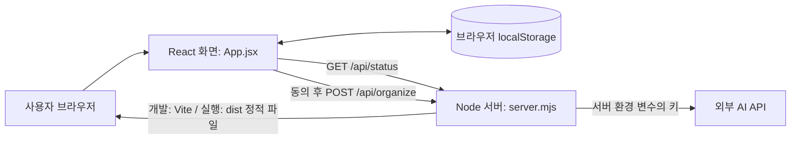

# 메이데이 시스템 아키텍처

> 기준일: 2026-11-14 · 현재 구조와 확장 조건을 구분한다. 디자인 구조는 다루지 않는다.

## 현재 구조

- `src/analysis.js`는 외부 요청 없이 기본 행동 템플릿과 시연 예시를 만들고 결과 출처를 구분한다. `AnalysisAddons.jsx`와 `ActionChecklist.jsx`는 결과의 부가기능 UI를 맡는다.
- `src/App.jsx`가 홈 입력, 감정·할 일 폼, 결과·할 일 화면, AI 호출, 로컬 기록 저장·조회·삭제, 체크리스트 팝업과 적용을 맡는다.
- 홈에서 상황 문장을 적으면 기본 정리 또는 동의한 AI 초안으로 결과 화면에 이동한다. 직접 정리하기는 기존 두 트랙 폼으로 이동한다. `src/components/GuidedChat.jsx`는 이전 대화형 가이드 코드로 남아 있지만 현재 화면에서 렌더링하지 않는다.
- `server.mjs`는 같은 출처에서 프런트엔드와 `/api/*`를 제공한다. 개발 모드에서는 Vite를 미들웨어로 쓰고, 실행 모드에서는 `dist/`를 제공한다.
- 기록은 기존 `daeumjang.reflections.v1` 키로 브라우저에 저장된다. 서버 DB, 계정, 여러 기기 간 동기화는 현재 없다.
- AI 요청은 동의한 경우에만 서버가 외부 API에 전달한다. 브라우저에 API 키를 전달하지 않는다. `/api/chat-turn`은 서버에 남아 있는 선택 경로이며 현재 기본 화면에서 호출하지 않는다.

## 이번 구현에서 지킬 경계

| 경계 | 책임 | 변경 원칙 |
| --- | --- | --- |
| 화면 | 유형 선택, 동의, 입력·수정, 상태 안내, 저장 의사 결정 | AI가 없어도 저장·조회·삭제 가능 |
| 브라우저 기록 | 현재 사용자 기록의 저장·정규화·조회 | 기존 `v1` 기록을 읽을 수 있어야 함 |
| 자체 서버 | 입력 검증, AI 호출 제한, 응답 형식 검증, 오류 응답 | 키는 서버에만 두고 요청 원문을 의도적으로 로그에 남기지 않음 |
| 외부 AI | 정리 초안 제안 | 사실·의도·원인을 판정한 결과로 취급하지 않음 |

빠른 MVP에서는 새 프레임워크나 DB를 도입하지 않는다. `App.jsx`가 커져 후속 기능이 늘 때는 **기록 저장 로직**, **AI 호출**, **화면별 컴포넌트**를 기능 단위로 분리할 수 있다. 현재 파일명과 저장 키를 한 번에 크게 바꾸지 않는다.

## 확장 경로와 시작 조건

| 수요가 확인되면 | 필요한 기술 결정 | 선행 확인 |
| --- | --- | --- |
| 저장 기록 편집 | `v1` 필드 유지, 수정 시점·충돌 처리 | 어떤 필드를 수정하려는지 사용자 관찰 |
| 여러 번의 체크리스트 적용 기록 | `usedAt`/`outcome` 단일 값에서 적용 이벤트 배열 또는 별도 엔터티로 이동 | 반복 사용이 실제로 일어나는지 |
| 계정·여러 기기 동기화 | 인증, 사용자별 접근 제어, 서버 저장, 마이그레이션, 삭제 정책 | 수요·운영 책임·개인정보 처리 결정 |
| 팀 공유 | 개인 기록과 공유 가능한 템플릿 분리, 권한 관리, 감사 가능성 | 개인 기록의 공유 범위에 대한 명시적 요구 |
| AI 사용량 증가 | 지속성 있는 제한·관측·비용 한도 | 현재 인메모리 제한으로 충분하지 않은 운영 규모 |

현재 제한은 프로세스 메모리에 있으므로 서버를 재시작하거나 여러 인스턴스를 쓰면 사용량이 분산된다. 계정이나 운영 규모를 확장할 때 별도 설계가 필요하다. 정적 파일만 호스팅하는 환경에서는 현재 `/api/organize`가 동작하지 않으므로 같은 출처 API를 제공하는 배포 구성을 확인해야 한다.

## 변경 시 함께 갱신할 문서

- 저장 필드·키 변경: [데이터·개인정보](DATA_PRIVACY.md), [기능 요구사항](REQUIREMENTS.md)
- API 변경: [API·AI 계약](API_AI_CONTRACT.md), [AI MVP 명세](../AI-MVP-구현명세.md)
- 확장 우선순위 변경: [로드맵](ROADMAP.md), [결정 기록](DECISIONS.md)
