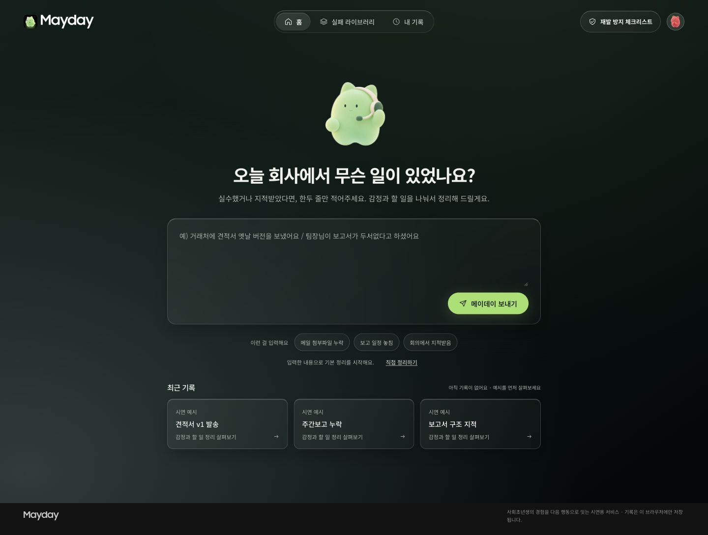
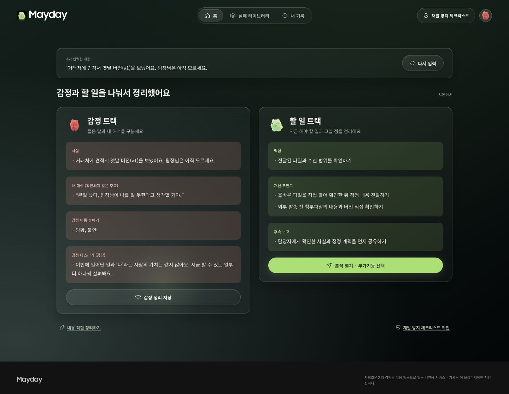
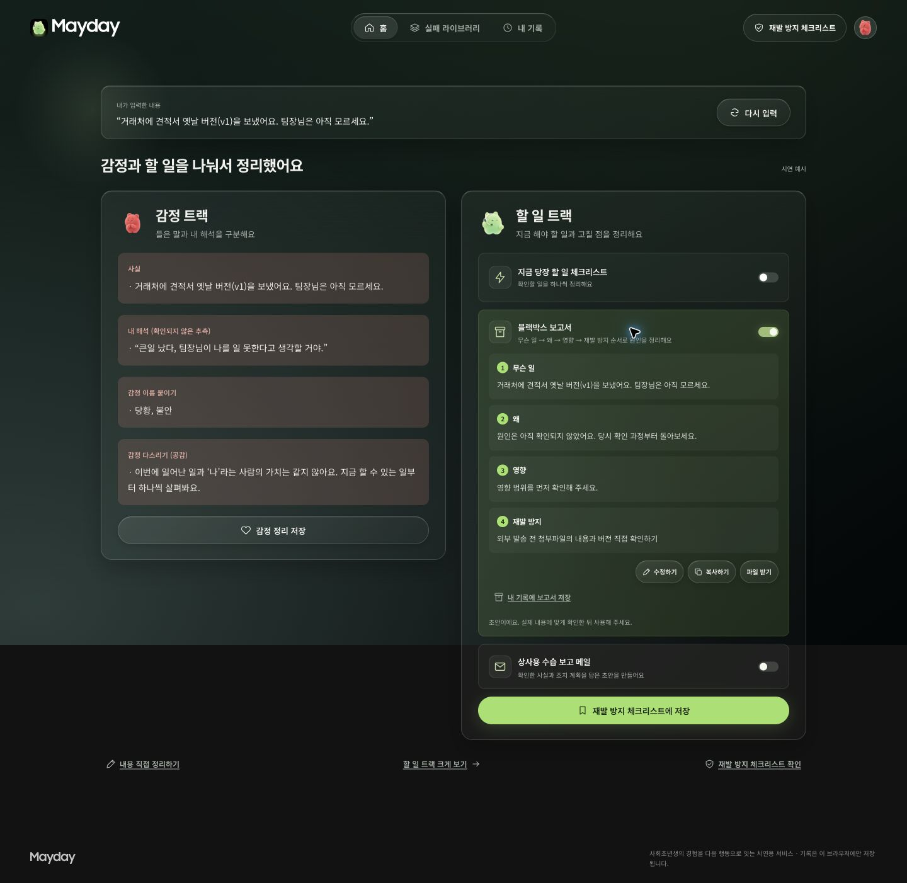
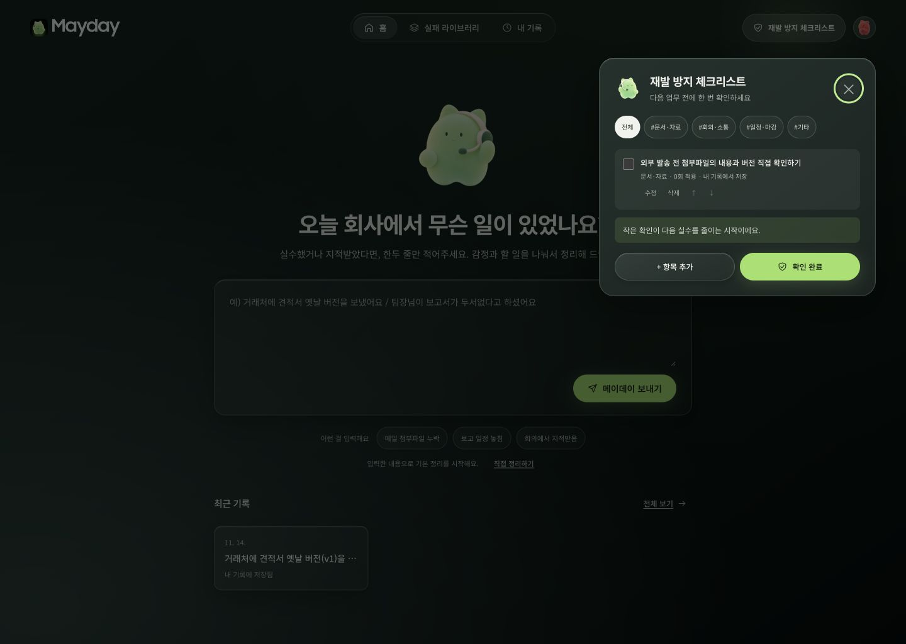
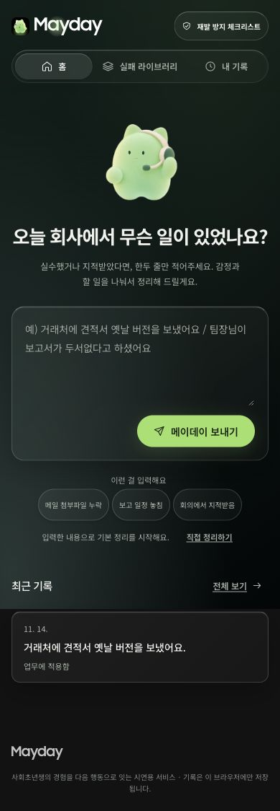
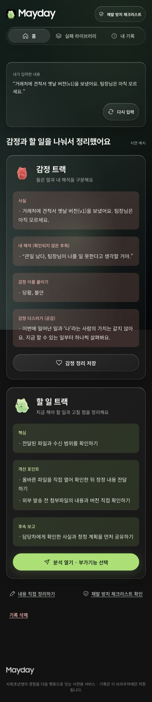
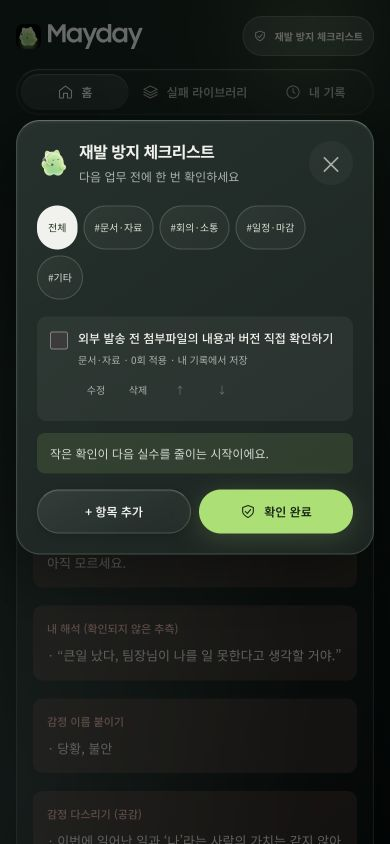

# Mayday Figma 디자인 구현 · 2026-11-14

## 구현 범위

- [원본 디자인](https://www.figma.com/design/JiW7EZGaBkJhjIv98mA6ps?node-id=84-213): 디자인 페이지의 1440px 화면을 브라우저에서 확인했다. Figma 연결 도구의 원본 데이터·에셋 추출은 편집 권한 제한으로 실패했다.
- 메인홈: 중앙 캐릭터, 760px 입력 카드, 상황 예시 칩, 최근 기록, 기록이 없을 때 명시적인 시연 예시 3개.
- 분석 결과: 상단 입력 요약, 코랄 감정 트랙, 녹색 할 일 트랙, 저장, 다시 입력, 직접 정리.
- 할 일 부가기능: 완료 체크와 진행률, 접기/펼치기, 블랙박스 보고서, 메일 톤 전환·편집·복사·텍스트 다운로드. 두 트랙 화면과 별도의 한 열 화면을 지원한다.
- 재발 방지 팝업: 업무 필터, 빈 상태, 추가·수정·삭제·순서 변경, 선택 항목 적용, 적용 횟수와 최근 시각 저장.
- 기존 기록 키와 API, 직접 입력 폼을 유지했다. 캐릭터 모션과 커서 컴포넌트의 병행 변경도 유지했다.

## 실제 동작과 데이터 경계

1. 기본 정리는 `src/analysis.js`의 로컬 템플릿이다. AI 결과로 표시하지 않으며 입력하지 않은 감정·원인을 만들어 넣지 않는다.
2. 실제 AI는 서버 환경 변수에 키가 있고 사용자가 전송에 동의할 때만 요청한다. 홈 요청에는 30초 타임아웃이 있으며 실패 시 입력 보존·재시도·기본 정리 경로가 있다.
3. 새 분석 결과는 저장 버튼을 누르기 전에는 React 상태에만 있다. 저장 후에는 기존 `daeumjang.reflections.v1`을 사용한다. 기본 정리에서 입력 문장은 `facts`에 포함된다.
4. 체크리스트는 `mayday.checklist.v1`에 저장한다. 목록을 보는 것만으로 적용 횟수를 늘리지 않으며, 선택 후 확인 완료를 눌러야 반영한다.
5. 시연 예시는 `source: demo`로 구분한다. 저장한 예시도 결과 화면에서 시연 예시로 표시한다.
6. 보고·메일은 자동 전송하지 않는다. 저장된 기록의 초안을 수정하면 해당 브라우저 기록에 반영한다.

## 검증 결과

| 검증 | 결과 |
| --- | --- |
| `npm run build` | 성공 |
| `node --test scripts/analysis.test.mjs` | 6개 통과 |
| `node scripts/smoke.mjs` | health, 정적 파일, SPA 경로, 응답 헤더, 키 없는 API 예외 처리 통과 |
| 홈 빈 입력 | 오류 문구와 입력 초점 확인 |
| 홈 입력 → 결과 → 부가기능 | 기본 정리 결과, 1/4 체크 진행률, 보고서 펼치기 확인 |
| 초안 편집 → 저장 → 새로고침 | 편집한 메일과 완료 체크 상태 유지 확인 |
| 체크리스트 적용 | 미선택 오류, 선택 후 적용, 홈의 적용 상태와 재조회 확인 |
| 빈 필터·항목 추가 | 기타 분류의 빈 상태와 새 항목 저장 확인 |
| 직접 입력 폼 | 필수값 누락 오류, 사실·체크리스트 입력 후 저장 확인 |
| 할 일 단일 화면 | 두 트랙에서 전환·복귀 확인 |
| 팝업 키보드 | Shift+Tab/Tab의 양방향 초점 순환, Escape 닫기, 이전 버튼 초점 복귀 확인 |
| 반응형 | 홈 320/390/768/1024/1440px, 결과 320/390/768/1440px 확인. 측정한 주요 요소의 가로 넘침 없음 |
| 이미지 | 관찰한 홈·결과 화면의 로컬 이미지 로드와 표시 크기 확인 |
| 브라우저 콘솔 | 검증한 세션에서 error 로그 없음 |

브라우저 저장 테스트는 기존 5173 기록을 변경하지 않도록 별도 로컬 포트 5174에서 수행했다. 실제 외부 AI 호출은 API 키가 없어 검증하지 않았다. 전체 색상 대비 감사, Safari·Firefox, 실제 휴대기기 테스트는 수행하지 않았다. 에셋 원본 추출 제한과 기존 캐릭터 모션 때문에 Figma와 픽셀 단위 완전 일치를 보증하지 않는다.

## 화면

### 데스크톱 홈

### 분석 결과

### 블랙박스 보고서

### 재발 방지 체크리스트

### 모바일

