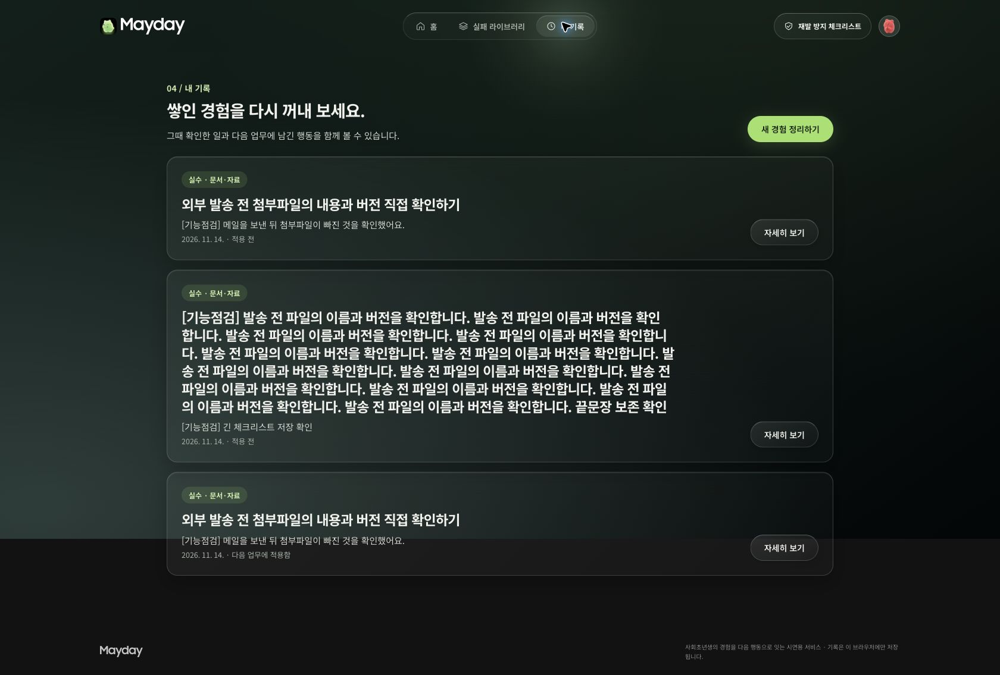
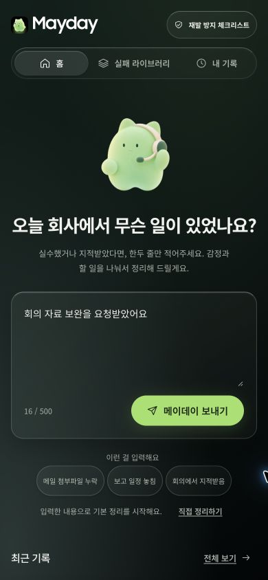
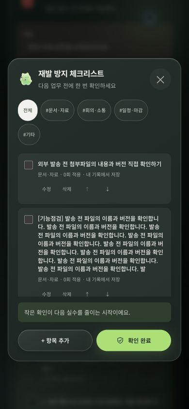

# 메이데이 기능 사용 가능 여부 점검

점검일: 2026-11-14 (한국 시간)

## 판정

**기본 시연 흐름은 사용할 수 있지만, 전체 기능이 완성된 상태는 아니다.**

- 상황 입력 → 기본 정리 → 할 일 확인 → 기록 저장 → 재조회가 동작한다.
- 보고서·메일 초안 표시, 메일 편집·복사·텍스트 다운로드, 체크리스트 관리의 주요 동작을 확인했다.
- 실제 AI는 현재 실행 중인 API 서버에서 설정되지 않았다.
- 긴 체크리스트가 다시 읽을 때 잘리는 문제와 기록 편집이 새 기록을 만드는 문제를 재현했다.
- 계정, 서버 DB, 기기 간 동기화, 실제 메일 발송, 사용자 간 실패 사례 공유는 현재 제공하지 않는다.

## 환경과 범위

- 작업 폴더: `/Users/do_not_delay/Desktop/UMC/UMC_HalfHackaton`
- 브랜치: `main`, 점검 시작 전부터 다수의 미커밋 변경과 새 파일이 있었다.
- Node.js: `v24.15.0`, 빌드에 사용된 Vite: `8.3.8`
- 현재 소스를 빌드한 뒤 `127.0.0.1:5197`의 별도 서버와 Chrome에서 가상 입력으로 확인했다.
- 테스트 서버는 `OPENAI_API_KEY=''`로 실행했다. 실제 서버의 AI 설정 여부는 별도로 `/api/status` 응답을 확인했다.
- 기존 5173·5174 주소의 사용자 기록은 변경하지 않았다. 테스트용 5197 브라우저 저장 공간에만 가상 기록을 만들었다.
- 앱 소스는 수정하지 않았다. 빌드 산출물을 다시 생성하고 이 보고서와 화면 증거를 추가했다.

## 기능별 결과

| 기능 | 판정 | 확인한 범위 |
| --- | --- | --- |
| 홈 입력 | 통과 | 빈 입력 오류와 입력 초점, 정상 문장 제출 |
| 기본 정리 | 통과 | 입력한 사실 유지, 감정·원인을 임의로 채우지 않음, 업무별 행동 템플릿 |
| 직접 정리 폼 | 통과 | 필수값 누락 안내, 사실·체크리스트 입력 후 저장 |
| 감정·할 일 화면 | 통과 | 두 트랙 표시, 부가기능 펼치기, 할 일 트랙 단독 화면 |
| 할 일 체크 | 통과 | 1/4 진행률 표시, 저장·새로고침 후 체크 유지 |
| 내 기록·최근 기록 | 통과 | 저장한 항목 표시와 재조회 |
| 저장한 내용 직접 수정 | 문제 재현 | 기존 기록 갱신 대신 별도 기록을 추가함 |
| 블랙박스 보고서 | 부분 확인 | 보고서 표시와 확장 화면을 확인. 보고서 편집·내려받기는 별도 실사용 검증하지 않음 |
| 메일 초안 | 통과 | 격식/부드러운 톤 전환, 편집, 복사, 저장 후 재조회 |
| 메일 텍스트 다운로드 | 통과 | 다운로드된 파일 내용이 편집한 문장과 동일함을 파일에서 확인 |
| 체크리스트 분류 | 통과 | 전체·기타 필터와 비어 있는 분류 안내 |
| 체크리스트 추가·수정 | 통과 | 직접 추가, 문구 수정, 다시 조회 |
| 체크리스트 순서 변경 | 통과 | 위로 이동 버튼으로 순서 변경. 마우스 드래그는 미검증 |
| 체크리스트 적용 | 통과 | 미선택 오류, 선택 후 적용 횟수 1회 표시, 기록의 적용 상태 반영 |
| 적용 결과 | 부분 확인 | 결과 입력·저장 후 동일 화면에서 값 유지. 별도 새로고침 재조회는 미검증 |
| 긴 체크리스트 | 문제 재현 | 직접 입력 304자 → 새로고침 후 팝업 목록 200자로 잘림 |
| 팝업 키보드 | 통과 | Escape 닫기, 헤더의 열기 버튼으로 초점 복귀 |
| 실패 라이브러리 | 시연 예시 | 고정 예시 표시, 예시를 홈 입력으로 가져오기. 실제 사용자 공유 데이터가 아님 |
| 실제 AI 정리 | 사용 불가 | 실행 중인 API 서버의 `available:false`. 실제 외부 AI 호출은 미검증 |
| 이전 대화형 가이드 | 기본 화면에서 접근 불가 | `GuidedChat`과 `/api/chat-turn` 코드는 있으나 현재 화면에서 chat 페이지로 진입하는 연결이 없음 |
| 기록·항목 삭제 | 코드 확인만 | 삭제 구현은 존재하나 실제 삭제 동작은 이번 브라우저 점검에서 실행하지 않음 |
| 모바일 | 제한된 범위 통과 | Chrome 390×844의 홈·분석·팝업에서 페이지 가로 넘침 없음, 홈 이미지 로드 확인 |

## 재현한 문제와 수정 위치

### 1. 긴 체크리스트가 새로고침 후 잘림

- 위치: `src/checklistStore.js:25`, `src/App.jsx:67`
- 직접 정리 폼의 공통 Field는 최대 1200자를 허용한다.
- `checklistFromRecord`는 그 문자열을 그대로 저장하지만, `readChecklistItems`는 읽을 때 `slice(0, 200)`을 적용한다.
- 재현: 직접 정리 폼에 304자 체크리스트를 입력하고 저장 → 팝업에서 끝문장 표시 확인 → 새로고침 → 팝업에서 끝문장이 사라지고 200자만 표시됨.
- 원래 경험 기록에는 304자가 남지만 체크리스트 화면과 불일치한다. 이후 목록 저장 작업이 발생하면 잘린 값이 체크리스트 저장소에도 반영될 수 있다.
- 별도 Node 재현 결과: `inputLength:304`, `reloadedLength:200`, `hasEnding:false`.
- 권장 수정: 기록과 체크리스트의 허용 길이를 통일하고, 기존 긴 문자열을 읽을 때 임의로 잘라내지 않는다.

### 2. 저장한 기록의 편집이 새 기록을 생성

- 위치: `src/App.jsx:360`의 `saveDraft`, `src/App.jsx:699`의 직접 정리 진입 동작.
- 재현: 기존 기록 열기 → 내용 직접 정리하기 → 감정 내용 수정 → 두 트랙 저장하기 → 내 기록.
- 결과: 기존 기록은 유지되고 같은 사실·체크리스트의 새 항목이 추가됐다. 목록의 기록 수는 2개에서 3개로 증가했다.
- `saveDraft`는 항상 새 ID를 생성하고 `actionChecked:[]`, `addonDrafts:{}`, `usedAt:null`, `outcome:''`으로 시작한다.
- 기존 원본 데이터가 삭제된 것은 아니다. 다만 사용자가 이어서 편집했다고 생각하는 새 복사본에는 완료 상태, 편집한 메일, 적용 이력이 이어지지 않는다.
- 권장 수정: 신규 작성과 기존 기록 편집을 구분하고, 편집 시 기존 ID와 관련 상태를 유지한다. 복사 저장이 의도라면 버튼에 이를 명시한다.



### 3. 실행 주소와 AI 연결 상태

점검 당시 응답:

| 포트 | `/api/status` 응답 | 의미 |
| --- | --- | --- |
| 5173 | 200, HTML 화면 | API 상태 응답이 아님. 이 주소에서는 현재 API 연결을 확인할 수 없음 |
| 5174 | 200, `{"available":false}` | API 서버는 응답하지만 AI 키가 설정되지 않음 |
| 4181 | 200, `{"available":false}` | 같은 상태 |
| 5588 | 200, `{"available":false}` | 같은 상태 |

- 5173에서 화면이 보인다고 API까지 동작하는 것은 아니다.
- `server.mjs`로 화면과 API를 함께 제공해야 한다.
- 서버에 `OPENAI_API_KEY`를 설정하고 재시작한 뒤 실제 샘플로 응답을 검증해야 한다. `available:true`만으로 모델 접근이나 성공을 보증할 수 없다.
- UI에 표시되는 현재 기본 정리는 로컬 규칙과 템플릿이다.

## 실행한 검사

```bash
npm run build
node --test scripts/analysis.test.mjs
node scripts/smoke.mjs
```

- 빌드 성공: 27개 모듈, JS 약 293.69 kB / gzip 89.46 kB.
- 기존 분석·저장소 테스트: 6개 통과, 실패 0개.
- 배포 형태 smoke 검사: health, 정적 파일, SPA 경로, 응답 헤더, API fallback 통과.
- 처음 smoke 실행은 실행 환경의 로컬 포트 개방 제한으로 중단됐고, 해당 실행 권한을 사용한 재실행은 통과했다. 앱 실패와 구분한다.
- 브라우저 점검 세션에서 수집한 error/warn 로그는 없었다.
- 메일 다운로드 이벤트 관측 도구는 시간 초과했지만, 실제 다운로드 파일은 생성되었고 내용도 일치했다. 따라서 다운로드 기능 실패로 분류하지 않았다.
- 저장 공간 초과/쓰기 거부, 실제 AI 성공·실패·시간 초과, Safari/Firefox, 실제 휴대전화, 전체 접근성 감사는 이번에 수행하지 않았다.
- `docs/VALIDATION_QA.md`에는 테스트 스크립트가 없다는 오래된 문구가 남아 있어 현재 코드와 다르다.

## 사용과 재검증

현재 API 응답이 확인된 개발 주소는 `http://127.0.0.1:5174/`이다. 실행 상태는 이후 달라질 수 있다.

새 개발 서버를 실행할 때 기존 서버와 포트가 겹치지 않도록 한다.

```bash
PORT=5197 npm run dev
```

수정 후에는 긴 체크리스트 보존과 기존 기록 편집에 대한 회귀 검사를 추가하고, AI 키 설정 후 가상 업무 문장으로 실제 응답을 확인해야 한다.




