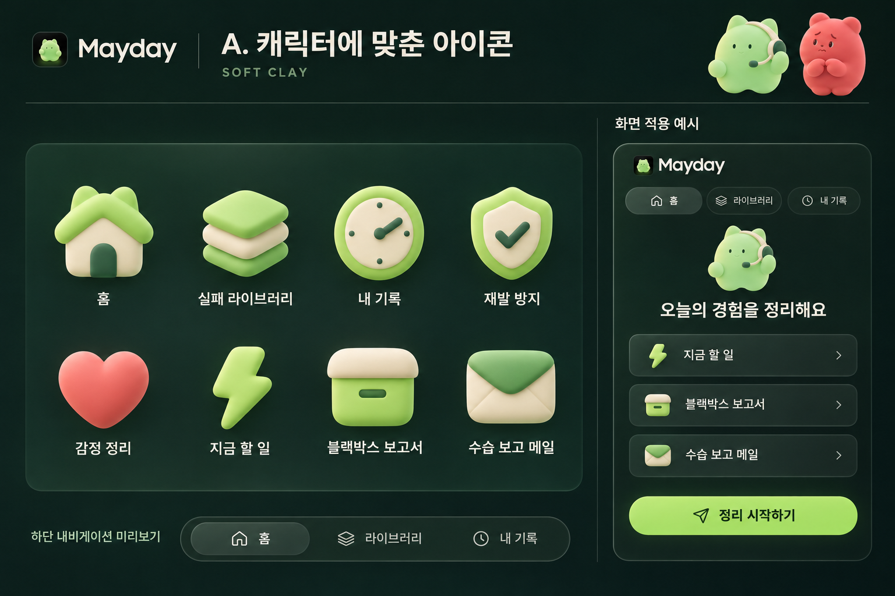
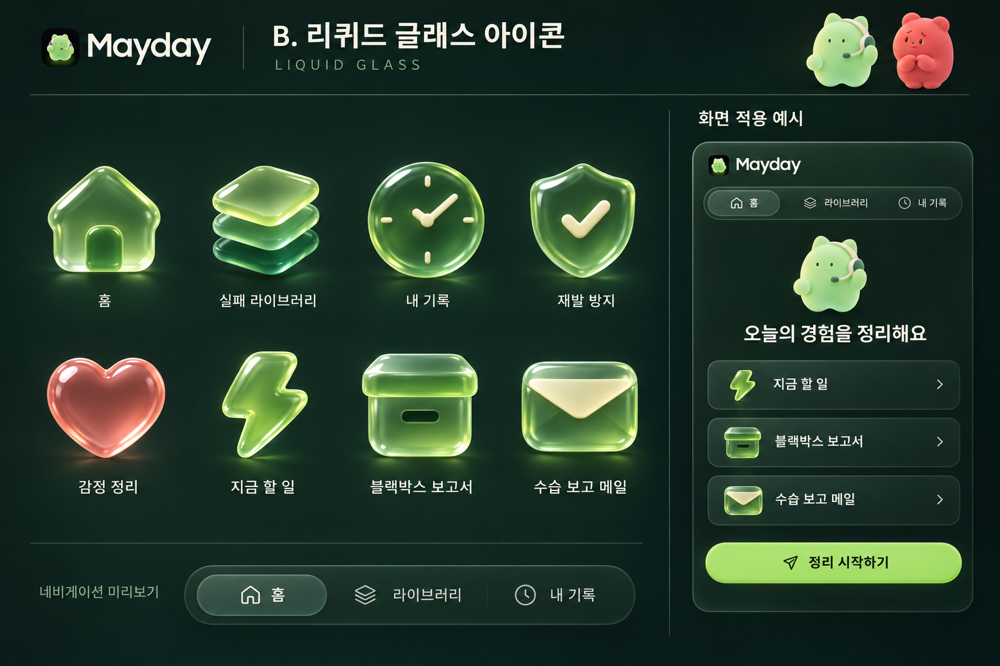

# Mayday 아이콘 교체 방향 비교

작성일: 2026-11-14 (Asia/Seoul)

## 1. 현재 문제 요약

현재 공통 아이콘은 `src/components/Icon.jsx`의 24 × 24 viewBox, 1.6px stroke 선 아이콘이며 기본 표시 크기는 16px이다. 주요 기능 카드에서는 20px로 사용한다. 화면은 짙은 초록 배경과 유리 패널을 사용하고, 메인 캐릭터는 연두색·크림색의 부드러운 3D 재질이다. 감정 트랙에는 코랄 캐릭터를 사용한다. 현재 구성은 기능 인식이 쉬우나 아이콘에서 캐릭터의 재질과 개성이 충분히 이어지지는 않는다.

확인한 소스: `src/components/Icon.jsx`, `src/App.jsx`, `src/components/AnalysisAddons.jsx`, `src/components/ActionChecklist.jsx`, `src/tokens.css`, `src/mayday.css`, 캐릭터 원본과 기존 QA 스크린샷.

## 2. 수정 방향

**추천: A안의 클레이 아이콘을 주요 기능에 사용하고, 기존 유리 패널과 조합한다.** 캐릭터와 아이콘의 재질이 이어지며, 어두운 패널 위에서 형태가 비교적 명확하다. 업무 실수와 감정을 정리하는 서비스에 부드러운 인상이 어울린다는 디자인 판단이다. 사용자 테스트 결과는 아니다.

| 비교 항목 | A — 캐릭터에 맞춘 클레이 | B — 리퀴드 글래스 |
| --- | --- | --- |
| 시각적 특징 | 연두·크림색, 둥근 모서리, 부드러운 음영 | 투명한 초록 유리, 밝은 가장자리, 반사와 굴절 |
| 강점 | 기존 캐릭터와 일관성, 친근함, 명확한 덩어리 | 유리 패널과 재질 연결, 세련된 인상 |
| 적용 시 조정 | 큰 기능 아이콘에 집중하고 작은 기호는 단순화 | 반사광과 투명도를 줄여 작은 형태의 가독성 확보 |
| 추천 위치 | 할 일·보고서·메일·체크리스트 등 주요 기능 | 브랜드 소개나 큰 기능 미리보기 |

두 시안은 같은 8개 기능을 비교한다. 생성 결과의 패널 배치·여백에는 약간의 차이가 있으므로 픽셀 단위의 통제된 A/B 실험은 아니다.

## 3. 수정 파일 목록

이 단계에서 추가한 파일:

- `mayday-icons-a-soft-clay.png`: A안 비교 보드, 1536 × 1024
- `mayday-icons-b-liquid-glass.png`: B안 비교 보드, 1536 × 1024
- `prompts.md`: 실제 사용한 생성 프롬프트
- `README.md`: 비교 근거와 적용 제안

실제 적용을 진행할 경우 확인할 파일은 공통 아이콘 컴포넌트, `src/mayday.css`의 아이콘 크기 및 여백, 그리고 주요 기능 카드 컴포넌트다. 현재 산출물은 디자인 방향을 검토하기 위한 시안이다.

## 4. 최종 코드 / 이미지 시안

이번 요청의 산출물은 코드가 아닌 이미지 시안이다. built-in `image_gen` 도구로 각 안을 한 장씩 생성했다.

### A — 캐릭터에 맞춘 클레이

### B — 리퀴드 글래스

공통 기능: 홈, 실패 라이브러리, 내 기록, 재발 방지, 감정 정리, 지금 할 일, 블랙박스 보고서, 수습 보고 메일.

오른쪽 화면은 아이콘 적용 분위기를 보여주는 생성 목업이다. 현재 실행 중인 서비스의 캡처가 아니며, 문구와 배치는 비교를 위해 재구성했다. 작은 내비게이션은 두 시안 모두 단순 선 아이콘으로 표현되었다. 확대된 홈·라이브러리·시계 아이콘은 스타일 후보이며 모든 탐색 메뉴를 입체 아이콘으로 교체한다는 의미는 아니다.

## 5. 실행 방법

PNG 두 장을 이미지 뷰어에서 열어 비교한다. 서버 실행이나 패키지 설치는 필요하지 않다.

## 6. 테스트 방법

완료한 확인:

- 생성 결과를 눈으로 확인해 두 안의 재질 차이, 기존 캐릭터와의 조화, 8개 기능의 대응 및 텍스트를 검토했다.
- 로컬 복사 후 두 PNG가 모두 1536 × 1024인지 확인했다.

실제 적용 단계에서 필요한 확인:

- 주요 기능 아이콘을 32–40px, 작은 조작 아이콘을 16–20px로 표시해 식별성을 확인한다.
- 현재 36px 아이콘 컨테이너에서 크기와 여백을 조정하고 모바일에서 줄바꿈을 확인한다.
- hover, selected, disabled 및 키보드 focus 상태를 점검한다.
- 기능 이름을 텍스트로 유지하고 장식 이미지는 중복 읽기를 방지하도록 alt="" 처리한다.

실제 브라우저에 새 아이콘을 적용한 가독성·반응형·접근성 테스트는 이번 단계에 포함되지 않는다. 애플리케이션 소스를 변경하지 않아 빌드는 실행하지 않았다.

## 7. 예상 결과

A안을 주요 기능에 적용하면 연두 캐릭터, 코랄 감정 표현, 부드러운 기능 아이콘이 하나의 시각적 체계로 이어질 것으로 예상한다. 유리 패널은 현재 화면의 깊이감을 유지한다.

## 8. 추가 개선 가능 사항

- 선택한 안으로 개별 투명 배경 아이콘을 제작하고, 균일한 광학 크기와 패딩을 맞춘다.
- 주요 기능은 32–40px 입체 아이콘, 복사·닫기·화살표 등 작은 조작은 16–20px 단순 기호로 구성한다.
- 감정 기능만 코랄, 실행·정리 기능은 연두/크림으로 구분한다.
- 버튼 안에 들어가는 아이콘은 배경과 대비가 충분한 색으로 조정한다.
- 현재 PNG는 라벨·배경이 포함된 비교 보드이므로 개별 운영 아이콘은 별도 제작한다.

